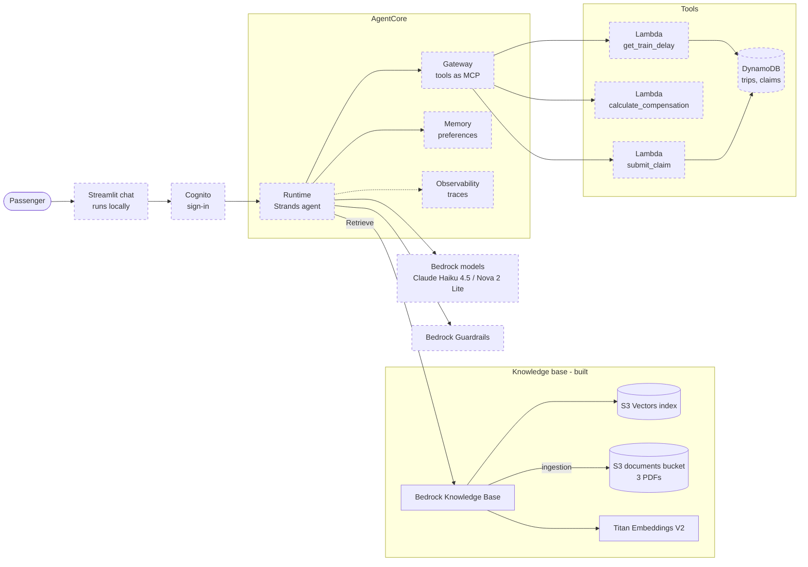

# Architecture

How the Rail Rights Agent is put together, which AWS services it uses and why. Each section links
to the `design.md` that made the decision; this file explains, the designs decide.

**Kept current by every change:** a change that adds or alters a component updates this file in
its own PR (rule in [`openspec/config.yaml`](../openspec/config.yaml)). Parts marked *planned*
follow [ROADMAP.md](ROADMAP.md) and may change when their milestone is designed.

Last updated by: `knowledge-base` (milestone 2).

## What the system does

A passenger asks, in German or English, about their rights after a delayed or cancelled train.
The agent answers from the actual legal texts (EU Regulation 2021/782 and the DB conditions of
carriage) and cites the passages. For a concrete trip it looks up the delay, computes the
compensation **in code**, shows a claim summary, and only after the passenger explicitly confirms
does it submit the claim.

## Status

| Component | AWS service | Milestone | Status |
|---|---|---|---|
| Project tags, region lock, cost budget | CDK, AWS Budgets | 1 `foundation` | built |
| Knowledge base over the legal texts | S3, S3 Vectors, Bedrock Knowledge Bases, Titan Embeddings V2 | 2 `knowledge-base` | built |
| Tools: delay lookup, compensation, claim submission | Lambda, DynamoDB | 3 `tools` | planned |
| Agent (local) | Strands Agents, Bedrock (Claude Haiku 4.5, Nova 2 Lite) | 4 `agent-local` | planned |
| Hosted agent | AgentCore Runtime, Gateway, Memory, Cognito | 5 `agentcore` | planned |
| Safety filters | Bedrock Guardrails | 6 `guardrails` | planned |
| Evaluation | Bedrock inference, GitHub Actions | 7 `evaluation` | planned |
| Chat UI and tracing | Streamlit (local), AgentCore Observability, CloudWatch | 8 `ui-observability` | planned |

## The big picture

Solid boxes are deployed today; dashed boxes are planned.

## One request, end to end

The target flow once milestone 5 lands. Steps 3–4 work today through the retrieval CLI.

1. The passenger writes *"Mein ICE hatte 90 Minuten Verspätung, was steht mir zu?"* in the
   Streamlit chat, which signs in with Cognito and calls the agent on **AgentCore Runtime**.
2. The **Strands agent** sends the conversation to the model (Claude Haiku 4.5 on Bedrock), with
   **Guardrails** filtering prompt attacks and off-topic requests.
3. The model asks for legal context. The agent calls **Bedrock Knowledge Bases** `Retrieve` with
   the question and `language=de`.
4. The knowledge base embeds the question with **Titan V2**, searches the **S3 Vectors** index
   (only German chunks, via a metadata filter) and returns the top passages with document,
   language, page and score. Art. 19 of 2021/782 ranks first in the live tests.
5. The model asks for the trip. Through **AgentCore Gateway** the agent calls the
   `get_train_delay` **Lambda**, which reads **DynamoDB**.
6. The agent calls `calculate_compensation`. Python code applies Art. 19 (25 % from 60 minutes,
   50 % from 120) and the DB rules (€4 minimum and others). **The model never does this arithmetic.**
7. The model explains the result in German, citing the retrieved passages, and shows a claim
   summary.
8. Only after the passenger explicitly confirms does the agent call `submit_claim`, which needs a
   confirmation token and is idempotent. The claim is stored in DynamoDB.
9. **Memory** keeps the passenger's preferences for next time; **Observability** records the trace,
   tokens and latency.

## AWS services: what, why, and what was rejected

### AWS CDK (Python): all infrastructure — built
- **What:** every resource is defined in [`infra/`](../infra/). `scripts/deploy.sh` and
  `scripts/destroy.sh` create or remove everything in one command.
- **Why:** infrastructure is reviewable code, reproducible, and nothing is left running by
  accident. The CDK CLI is pinned through `npx`.
- **Guard rails:** every resource carries four project tags ([`infra/tagging.py`](../infra/tagging.py)),
  and a test checks every synthesised resource for them. The region is locked to `eu-north-1` in
  settings and by an account-level policy (SCP).
- Decision: [foundation design D5, D6](../openspec/changes/archive/2026-10-31-foundation/design.md).

### AWS Budgets: cost alarm — built
- **What:** a $20/month budget with email alerts at 50 % and 80 % of actual and 100 % of
  forecast spend ([`infra/stacks/budget.py`](../infra/stacks/budget.py)). Opt-in: deployed only
  when `RAILAGENT_BUDGET_EMAIL` is set.
- **Why:** the account runs on free-plan credit; using it up closes the account, so early warning
  matters.
- **Notable:** CloudFormation in eu-north-1 has no budget resource type, so CDK calls the Budgets
  API through a custom resource instead.
- Decision: [foundation design D7](../openspec/changes/archive/2026-10-31-foundation/design.md).

### Amazon S3: source documents — built
- **What:** a private, encrypted bucket holding the three PDFs plus a small `.metadata.json` per
  PDF that tags it with `document` and `language`.
- **Why the ingest command uploads them, not CDK:** `docs/source/` is not in git, so a CDK upload
  would break synthesis in CI.
- Decision: [knowledge-base design D5, D6](../openspec/changes/archive/2026-11-01-knowledge-base/design.md).

### Amazon S3 Vectors: vector store — built
- **What:** stores one embedding (1024 numbers) per text chunk and finds the chunks closest to a
  question (cosine distance).
- **Why:** pay per use with no idle cost, and Bedrock Knowledge Bases supports it as a store.
- **Rejected:** OpenSearch Serverless, which bills for capacity even when idle.
- **Limits to know:** semantic search only (no keyword/hybrid search); small metadata limits,
  which is why Bedrock's own text keys are stored as non-filterable.
- Decision: [knowledge-base design D3](../openspec/changes/archive/2026-11-01-knowledge-base/design.md).

### Bedrock Knowledge Bases: ingestion and retrieval — built
- **What:** on ingestion it reads the PDFs from S3, splits them into chunks (300 tokens, 20 %
  overlap), embeds each chunk and writes it to S3 Vectors. On `Retrieve` it embeds the question
  and returns the best-matching passages with their source.
- **Why:** managed parsing, chunking and embedding. We call only `Retrieve`, not
  `RetrieveAndGenerate`: the agent writes the answer and the citations itself.
- **Code:** [`retrieval.py`](../src/rail_rights_agent/knowledge_base/retrieval.py) (`KnowledgeBaseRetriever`,
  used by the agent and the eval harness later) and
  [`ingest.py`](../src/rail_rights_agent/knowledge_base/ingest.py), driven by
  `python -m rail_rights_agent.knowledge_base ingest|retrieve`.
- **Permissions:** one service role that can call only the embedding model, read only the
  `documents/` prefix and write only this vector index.
- Decision: [knowledge-base design D1, D4, D7, D8](../openspec/changes/archive/2026-11-01-knowledge-base/design.md).

### Titan Text Embeddings V2: embedding model — built
- **What:** turns text into vectors, in German and English.
- **Why:** the only Knowledge Base embedding model available in eu-north-1 itself; multilingual;
  $0.00002 per 1K tokens.
- **Rejected:** Cohere Embed v4 (better multilingual quality, but reachable here only through a
  cross-region profile that Knowledge Bases don't document support for).
- **Trade-off:** cross-language matching is weaker, so the agent filters by the user's language.
- Decision: [knowledge-base design D2](../openspec/changes/archive/2026-11-01-knowledge-base/design.md).

### AWS Lambda and DynamoDB: tools — planned (milestone 3)
- `get_train_delay` (over mock trip data), `calculate_compensation` (deterministic Python) and
  `submit_claim` (idempotent, needs a confirmation token), as thin Lambda handlers over plain
  Python functions. Two on-demand DynamoDB tables: trips/delays and claims.
- **Why:** pay per call, ~$0 within the free tier. DynamoDB is the single source of truth for claims.

### Bedrock models and Strands Agents: the agent — planned (milestone 4)
- Strands drives the loop: the model decides which tool to call, the agent runs it, the model
  writes the answer. Primary model Claude Haiku 4.5, compared against Nova 2 Lite (both EU
  cross-region inference profiles).

### AgentCore Runtime, Gateway, Memory and Cognito: hosting — planned (milestone 5)
- **Runtime** hosts the agent, billed only while a request is active. **Gateway** exposes the
  Lambdas to the agent as MCP tools. **Cognito** signs callers in. **Memory** keeps preferences
  and session summaries, never claims.
- **Rejected:** Bedrock Agents (Classic), which is closed to new customers.

### Bedrock Guardrails — planned (milestone 6)
- Prompt-attack filter, denied topics, PII masking in outputs, logs and Memory. Claim fields reach
  `submit_claim` unmasked, or the claim would lose the data it needs.

### AgentCore Observability and CloudWatch — planned (milestone 8)
- Traces, token usage and cost per conversation.

## Rules the architecture enforces

| Rule | Where it is enforced |
|---|---|
| Compensation is computed in code, never by the model | `calculate_compensation` tool (milestone 3), its table-driven tests |
| No claim without explicit confirmation | confirmation token in `submit_claim`; agent tests (milestone 4) |
| Every rights answer cites retrieved passages | `Passage` carries document, language, page; agent and eval tests |
| Only `eu-north-1` | settings check, account SCP |
| Every resource tagged | `apply_project_tags` and a test over all synthesised resources |
| No idle cost | no always-on compute; OpenSearch Serverless banned by a test |
| Model ids only in settings | `tests/unit/test_no_hardcoded_model_ids.py` |

## Cost model

Design target: about $0 while nothing is being used.

| Resource | Billed when | Typical cost |
|---|---|---|
| S3 documents, S3 Vectors storage | stored | cents per month |
| Titan embeddings | ingestion, every `Retrieve` | fractions of a cent |
| Budget | never | free |
| Lambda, DynamoDB on demand *(planned)* | per call | ~$0 (free tier) |
| Model inference *(planned)* | per token | ~$0.01–0.03 per conversation |
| AgentCore Runtime, Gateway, Memory *(planned)* | per active request or tool call | ~$1–3 over development |
| Guardrails *(planned)* | per text checked | < $1 per red-team run |

Estimates come from [ROADMAP.md](ROADMAP.md); each change re-checks its own.

## Where the code is

| Path | Contains |
|---|---|
| [`infra/app.py`](../infra/app.py) | builds every stack |
| [`infra/stacks/`](../infra/stacks/) | one file per stack: what exists in AWS |
| [`src/rail_rights_agent/settings.py`](../src/rail_rights_agent/settings.py) | all configuration (`RAILAGENT_*`), model ids, region lock |
| [`src/rail_rights_agent/knowledge_base/`](../src/rail_rights_agent/knowledge_base/) | document catalogue, ingestion, retrieval, CLI |
| [`tests/infra/`](../tests/infra/) | checks on the synthesised CloudFormation |
| [`tests/unit/`](../tests/unit/) | offline behaviour tests (AWS stubbed) |
| [`tests/live/`](../tests/live/) | billed checks against real AWS; run only with approval |
| [`openspec/specs/`](../openspec/specs/) | what each capability must do |
| [`openspec/changes/archive/`](../openspec/changes/archive/) | every change's proposal and design: the "why" |
